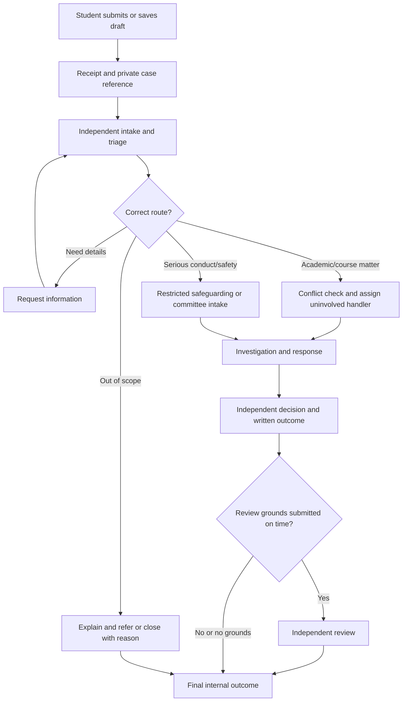

# Ambo CMS: Workflow and Architecture Design Proposal

**Purpose:** A research-backed proposal for making complaint handling consistent, fair, privacy-aware, and explainable in a project review. This is a design recommendation, not an adopted Ambo University policy. The university must approve the decision rules, deadlines, office responsibilities, and legal handling before production use.

## Recommendation in brief

Build one authoritative, auditable case workflow and use it in both the browser demo and the PHP/MySQL backend. Keep complaints, appeals/reviews, referrals, and anonymous reports distinct, while linking related records. Give students a protected-identity option for trackable formal cases and a separate anonymous-report channel with clear limits. Do not promise absolute anonymity.

This is a better foundation than adding more screens or API endpoints first: the current prototype has mismatched status paths, unrestricted status changes, and an “anonymous” display mode that still stores the student identity on the complaint. If we connect that directly to a backend, those ambiguities become institutional records and access-control problems.

## What the repository currently does

- The browser prototype stores its complaints and current demo identity in `localStorage`; changing the demo role is not authentication or authorization.
- `addComplaint()` sends a serious complaint directly to `committee_review`. The milestone report instead says every complaint first receives administrative triage. Decide whether serious cases need safe intake before referral; the alleged subject or implicated department must never control that triage.
- `updateComplaintStatus()` accepts arbitrary status changes. It does not check which role may perform a transition or whether the transition is valid.
- JavaScript, PHP constants, SQL enums, and policy documents use overlapping but different roles and statuses. For example, SQL has `committee`, `escalated`, `assigned`, and `committee_review`; PHP constants omit committee and several statuses.
- The anonymous submission currently uses a masked display name/ID and sets `isAnonymous`, but the SQL complaint has a required `student_id` foreign key. That is **identity masking**, not true anonymity. The UI should describe the actual privacy promise precisely.

## Proposed case model

Use a case record with explicit dimensions instead of overloading one status field:

| Field | Meaning | Example values |
|---|---|---|
| `case_type` | Which institutional procedure owns the matter | `academic_complaint`, `grade_appeal`, `staff_conduct`, `anonymous_concern`, `group_complaint` |
| `route` | Current responsible office/process | `department`, `independent_review`, `disciplinary_committee`, `external_referral` |
| `status` | Current work state | `submitted`, `triage`, `awaiting_information`, `assigned`, `investigating`, `response_submitted`, `outcome_issued`, `review_requested`, `reviewing`, `closed`, `referred`, `withdrawn` |
| `identity_mode` | How identity is handled | `identified`, `confidential`, `anonymous` |
| `parent_case_id` / `related_case_id` | Link review, duplicate, group, or new-incident records without overwriting history | original case reference |

Store transitions as events: actor, role, event/action, previous and new status, timestamp, reason, relevant evidence references, and notification decision. The server should validate each transition against a single policy map. The UI may display simpler labels, but must not invent a second workflow.

### Proposed normal flow

This is a proposal for the case lifecycle, not a claim that every issue must follow exactly the same path. Grade appeals, harassment investigations, facilities referrals, and general service complaints can have distinct procedures while sharing identity, audit, notification, and review primitives.

### Roles and separation of duties

- **Student/complainant:** submits, provides evidence, sees permitted updates, requests review, and can report a new incident.
- **Intake/case officer:** checks scope, urgency, conflicts, jurisdiction, and the safe route. A named role could be added; do not make the person accused or their direct reporting line the sole gatekeeper.
- **Teacher/respondent:** receives only the allegation and evidence needed to respond, with the institution’s approved redactions; cannot see confidential contact details or edit the student’s submission.
- **Department administrator:** assigns eligible routine academic cases, monitors deadlines, and issues/approves outcomes only where impartiality checks pass.
- **Independent reviewer/appeal panel:** reviews process/outcome grounds without having decided the original case. This should be a separate function from the disciplinary committee.
- **Disciplinary committee/safeguarding office:** handles serious conduct matters under a restricted docket. It should not be a general-purpose appeal body for ordinary grading disagreements.
- **System administrator:** manages the service, not case merits; privileged data access should be logged and limited.

If the coursework scope must retain only four demo roles, model the independent intake/review as a permission and assignment within the admin/committee demo accounts, clearly label that as a simulation, and document the real institution’s need for independence. Do not silently imply the department admin is independent when reviewing their own decision.

## Anonymous, confidential, and identified reports

Offer two different privacy modes for a formal case and a separate anonymous tip/report path:

1. **Identified formal case:** identity is visible to authorized case staff and shared only as the procedure requires. The student receives updates and can request a review.
2. **Confidential formal case (recommended default for sensitive matters):** the institution knows who filed; the respondent and ordinary department queue do not see the identity unless disclosure is necessary for a fair investigation or legally required. The student can communicate and receive an outcome. Use role-based field-level views, not fake names or fake student IDs.
3. **Anonymous concern:** no identity is collected; give a random tracking code plus secret/passphrase so the reporter can check status and answer questions without an account. Explain that the institution may be unable to verify, investigate, provide an individual remedy, or tell the reporter the result. Credible safety or misconduct information can still trigger a risk assessment or pattern review.

Show a plain-language notice before submission: what identity is collected, who can see it, what may have to be disclosed, what can be investigated anonymously, and how to request help safely. Avoid saying “guaranteed anonymous.” Details, attachments, timestamps, or identifying incident facts can reveal a reporter even when the name is hidden. Store identity separately or protect it with strict field-level authorization; do not rely on the client hiding it. Ethiopian Personal Data Protection Proclamation No. 1321/2024 is in force and includes processing principles and security obligations, so the data model and notice require institutional privacy/legal review.

**Why this approach:** university practice varies. Sheffield and York normally do not accept anonymous formal complaints because anonymity impedes investigation and fairness; Edinburgh Napier may consider one when there is enough information and requires senior authorization for a decision not to pursue a serious anonymous report. London Met describes anonymous reports as useful for trend monitoring while warning that investigation/outcome may be limited. This supports giving students a real confidential case option plus a distinct anonymous-report option, rather than treating masking as anonymity.

## Dissatisfaction, appeals, and repeat complaints

The system should let a student challenge an unsatisfactory outcome without encouraging duplicate records or permitting endless re-litigation.

| Scenario | Recommended system behavior | Why |
|---|---|---|
| Student says “I disagree” but gives no review ground | Accept a review request for screening; explain that disagreement alone may not qualify; provide the written decision and grounds | A review route preserves voice while setting a fair threshold. UCL and the University of London use defined review grounds rather than a fresh re-hearing on dissatisfaction alone. |
| New evidence could not reasonably have been supplied earlier | Attach a review request to the original case; record why it is new; independent reviewer decides whether it could change the result | Avoids overwriting the original record and gives material evidence a route. |
| Process error, bias/conflict, missed evidence, or unreasonable remedy alleged | Route to an uninvolved reviewer; capture ground(s), evidence, remedy sought, and deadline | University review processes commonly define process error, new evidence, bias, or unreasonable outcome/remedy as review grounds. |
| Same issue already decided; no new evidence or process ground | Link as duplicate/repeat request; explain finality and any available external route; do not delete the submission | Prevents double work and preserves an auditable record without treating mere repetition as proof of bad faith. |
| New incident after the first case | Create a new case linked to the prior case; assess the new facts independently and check for retaliation | A new event is not a duplicate, even when people or context overlap. |
| Alleged retaliation after filing | Create a linked urgent case, restrict access, notify a safe independent office, and preserve evidence | Retaliation is a separate alleged act and must not be buried as a status note on the original case. |
| Multiple students report the same course-wide issue | Offer a group case with a named representative and individual confidential submissions/consent | Group procedures at Sheffield and Westminster use representative/spokesperson models; individual privacy and consent still need protection. |
| Anonymous reporter returns with more information | Use the private code to append an audited update to the anonymous report; do not force account creation | Enables two-way follow-up while honoring the selected mode. |
| Case was closed but genuinely material evidence appears later | Allow a controlled reopen/review linked to the closed case, with an authorized decision and audit event | Reopening should be exceptional and transparent, not editing history. |
| Complaint is about a grade/academic judgment | Route to the published grade/academic appeal process; distinguish process error or policy violation from disagreement with academic judgment | Some universities explicitly separate grade appeals from general complaints and limit complaint review to procedural issues. Ambo must define its own jurisdiction. |
| Complaint concerns immediate harm, harassment, or a conflict involving the department head | Skip ordinary teacher/department routing and refer to a restricted independent safeguarding/disciplinary channel; include urgent safety contact options | Safety and impartiality outweigh ordinary queue order. Do not notify an implicated person before the safe authority assesses disclosure. |
| Complaint is outside system scope (e.g. campus facilities) | Explain why, provide destination/contact and referral consent where possible; record referral/closure reason | A respectful referral is clearer than a bare decline. |
| Student withdraws | Mark withdrawn with date/reason; allow the institution to continue where safety/legal/public-interest duties require, subject to policy | Withdrawal should be recorded but not assumed to erase an institutional duty to act. |
| Evidence is missing or deadlines are missed | Request clarification, allow a reasoned extension/exception, and issue a reasoned decision; make deadlines configurable by policy | Fairness requires notice and reasons; exact timelines differ across institutions and must be selected by Ambo. |

Set review grounds such as: (a) significant procedural error, (b) new material evidence not reasonably available, (c) conflict/bias, or (d) outcome/remedy unreasonable against the evidence or policy. Decide whether a student may appeal the merits of a grading decision through a separate academic appeal procedure. Use a university-approved time limit and extension policy; do not copy another university’s number without approval.

## Workflow decisions to settle with the supervisor/institution

These are policy choices, not code defaults:

1. Which complaint types are in this portal, and which must go to separate academic appeals, sexual harassment, staff discipline, student conduct, facilities, or safety processes?
2. Who is the independent intake owner, and who can see identity/evidence? What if the department head, teacher, or case officer is named?
3. Does Ambo accept anonymous reports, confidential formal complaints, or both? What can be promised about disclosure and outcome feedback?
4. Which matters can be investigated without a named complainant, and what minimum detail/evidence is needed?
5. What are acknowledgement, triage, update, decision, and review deadlines? What counts as business day, term break, extension, or paused clock?
6. What are review grounds, who reviews, the filing window, extension grounds, and whether there is a final internal stage?
7. Can a group complaint be filed? How are consent, group membership, and individual remedies represented?
8. What constitutes a duplicate, a new incident, a reopening, or an unreasonable repeat submission? Who decides, and how can that decision itself be reviewed?
9. When can serious allegations be investigated despite withdrawal or anonymity? Who conducts safety/risk assessment?
10. What retention/deletion rules apply to case files, messages, attachments, anonymous codes, and audit history?

## Architecture and implementation path

### Phase 1 — Approve the policy model

Produce a short state-transition table with allowed actor, preconditions, required fields, notification, SLA clock, and audit event for every action. Define canonical enums in one documented domain model. Treat status labels shown to students as display mappings only.

### Phase 2 — Make the demo honest and deterministic

Replace `updateComplaintStatus()` with action methods such as `assign`, `requestInformation`, `submitResponse`, `issueOutcome`, `requestReview`, `escalate`, and `refer`. Reject invalid transitions. Update the student-facing status mapping and the submission/privacy copy. Keep localStorage as a clearly labeled demo adapter.

### Phase 3 — Align the database and protect identity

Add data structures for review requests, related/group cases, identity mode, confidential identity access, decisions/outcomes, notifications, and transition events. Remove reliance on `isAnonymous` as the privacy mechanism. Use least-privilege queries and server-side access checks. Review attachment privacy and retention before real uploads.

### Phase 4 — Add server authority

Implement authentication and role/record authorization first, then API operations that call the same domain transition rules within database transactions. The browser may request an action; the server validates it and appends the event. Preserve a demo mode through the localStorage adapter, but never use demo role switching as backend authorization.

### Phase 5 — Demonstrate edge cases

Prepare scripted scenarios for routine academic complaint, grade appeal, anonymous serious report, confidentiality request, conflict of interest, unsatisfied student, new evidence, duplicate, new/retaliatory incident, group issue, out-of-scope referral, withdrawal, overdue case, and failed anonymous follow-up. For each, show the student view, staff view, allowed action, notification, and audit event.

## Why this is defensible in a project review

- **Fairness:** the person complained about does not control the review; the student gets reasons, status, and a defined challenge route.
- **Safety:** high-risk issues can bypass normal department assignment and receive restricted handling.
- **Privacy:** confidentiality is described as controlled disclosure, not an impossible guarantee; anonymous reports have realistic limits.
- **Consistency:** one transition policy and one canonical vocabulary govern the demo, API, and database.
- **Accountability:** every decision, referral, status change, access to protected identity, and review relationship can be audited.
- **Manageable workload:** repeat requests and duplicate reports are linked and screened; genuinely new incidents remain actionable.
- **Adaptability:** deadlines and jurisdiction live in approved policy configuration rather than being hard-coded from a foreign university’s timelines.

## Sources and how to use them

These are examples of institutional practice, not rules Ambo must copy. Policies differ by country, institutional authority, complaint type, and legal framework. The project should cite them as precedents for design choices, then label its own selected policy as a proposal pending Ambo approval.

1. **Ethiopian Ministry of Justice, Higher Education Proclamation No. 1152/2019** — national higher-education context; its student-rights provisions include fair treatment and protection from harassment. Use as local context, not as a complete complaint workflow specification. [Official Ministry of Justice law page](https://justice.gov.et/en/law/higher-education-proclamation-no-1152-2019/)
2. **Ethiopian Ministry of Justice, Personal Data Protection Proclamation No. 1321/2024** — in force; relevant to collecting, explaining, restricting, securing, and retaining student identity and sensitive case information. Confirm application and implementation with the institution’s legal/privacy office. [Official Ministry of Justice law page](https://justice.gov.et/en/law/personal-data-protection-proclamation/)
3. **University of Sheffield, Complaints Procedures** — anonymous complaints normally not accepted, with an exceptional evidence-backed route; describes group complaints and time limits. [Policy page](https://sheffield.ac.uk/study/policies/appeals-complaints-current-students/complaints-procedures)
4. **Edinburgh Napier University, Making a Complaint** — anonymous matters may be considered where enough information allows enquiries; serious anonymous complaints are escalated for senior consultation. [Policy page](https://my.napier.ac.uk/your-studies/regulations-conduct-and-safety/making-a-complaint)
5. **London Metropolitan University, Complaints Procedure** — anonymous reports may inform monitoring/prevention, while noting investigation and response may be limited. [Policy page](https://student.londonmet.ac.uk/your-studies/student-administration/rules-and-regulations/complaints-procedure/)
6. **University College London, Student Complaints Procedure** — review grounds include procedural irregularity and genuinely unavailable new evidence; disagreement alone is not enough. [Policy page](https://www.ucl.ac.uk/study/current-students/academic-manual/chapters/chapter-6-student-casework-framework/section-8-ucl-student-complaints-procedure)
7. **University of London, Complaints and Appeals Procedure** — staged handling, separate review, review criteria, timelines, and external review after internal completion. [Policy page](https://www.london.ac.uk/current-students/student-policies/complaints-appeals-procedure)
8. **University of Kent, Student Complaints Procedure** — formal outcome review grounds include procedural error and new evidence. [Policy page](https://www.kent.ac.uk/appeals-conduct-and-complaints-office/student-complaints)
9. **University of Sydney, Reporting Anonymously** — explains that anonymous reports may restrict investigation and feedback and that confidentiality has legal/practical limits. [Guidance page](https://www.sydney.edu.au/about-us/governance-and-structure/feedback-concerns-and-complaints/reporting-anonymously.html)
10. **The University of Sydney, Appealing the Outcome of Your Complaint** — distinguishes a process appeal from merely disagreeing with the result. [Guidance page](https://www.sydney.edu.au/students/complaints/appeal-outcome.html)
11. **The Chinese University of Hong Kong (CUHK), Procedures for Dealing with Student Complaints** — illustrates duplicate/repeated complaint controls and referral to a more appropriate procedure. [Policy page](https://www.gs.cuhk.edu.hk/policies-procedures/complaint-procedures)
12. **Western Sydney University, Complaint Management Policy** — accepts anonymous complaints with explicit limits, records matters, and allows reconsideration when further evidence arises. [Policy page](https://policies.westernsydney.edu.au/document/view.current.php?id=98&version=8)

## Limitation

I did not find an authoritative, publicly accessible Ambo University student complaint procedure in this research pass. The current repository’s `docs/INSTITUTIONAL_COMPLAINT_POLICY.md` is project documentation, not proof of an adopted university policy. Before presenting deadlines, anonymity promises, escalation authorities, or binding outcomes as institutional fact, verify them with the supervisor or Ambo’s applicable senate/student-affairs rules.
